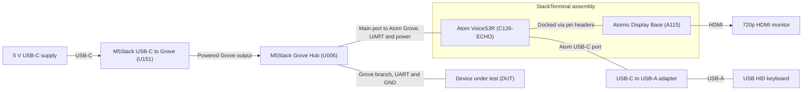

# StackTerminal

StackTerminal is a UART terminal for the M5Stack Atom VoiceS3R (C126-ECHO) and Atomic Display Base (A115). It runs a dark LVGL interface at 720p over HDMI and accepts a USB HID Boot keyboard using the Polish programmer layout.

Two dots at the right end of the top bar show UART activity. Green indicates receive (RX), and blue indicates transmit (TX).

## Hardware connections

Connect one powered Grove output on the USB-C to Grove unit to a branch port on the Grove Hub. Connect the DUT to another branch and the Atom's Grove port to the hub's main port. The hub wires its ports in parallel, so the USB-C supply feeds the Atom through the shared 5 V rail. [USB-C to Grove pinout](https://docs.m5stack.com/en/unit/Unit_TypeC_to_Grove#pinmap) · [Grove Hub documentation](https://docs.m5stack.com/en/unit/Unit_Hub)

Seat the Atom in the Atomic Display Base and connect the monitor to the base's HDMI port. Plug a data-capable USB-C to USB-A adapter into the Atom's own USB-C port, then plug the keyboard into the adapter. [Atomic Display Base documentation](https://docs.m5stack.com/en/atom/Atomic_Display_Base)

### Grove UART pinout

| Grove wire | Atom pin | DUT connection |
| --- | --- | --- |
| Black | GND | Common ground |
| White | GPIO1 / RX | DUT TX |
| Yellow | GPIO2 / TX | DUT RX |
| Red | 5 V supply | Leave disconnected at the DUT end if the DUT has its own power supply |

UART uses 3.3 V logic. Use the appropriate converter for 5 V UART, RS-232, or RS-485. The red Grove wire carries 5 V from the power supply. [Atom VoiceS3R pinout](https://docs.m5stack.com/en/core/Atom_VoiceS3R#pinmap)

## Getting started

1. Disconnect the Grove power feed. Connect the Atom directly to your computer over USB-C and put it into download mode using the reset button. [M5Stack flashing instructions](https://docs.m5stack.com/en/arduino/atom_echos3r/program)
2. Run `pio run -t upload` from the project directory.
3. Wire the setup as shown above. Type a character and check that it appears in the input field at the bottom of the screen.
4. Press Ctrl+Tab and set the terminal's UART parameters to match the DUT. The first boot uses 115200 baud, 8 data bits, no parity, and 1 stop bit (8N1).

## Keyboard controls

| Key | Action |
| --- | --- |
| Enter | Send the command and append CR and LF |
| Shift+Enter | Insert CR and LF at the cursor without sending |
| Ctrl+Enter | Send the command without appending a line ending |
| Up / Down | Recall sent commands. Moving past the newest command restores the draft |
| Left / Right, Home / End | Move the cursor or jump to the start or end of the line |
| Insert | Toggle insert and overwrite modes |
| Page Up / Page Down | Scroll received lines by one page. The last page follows new data |
| Ctrl+Up / Ctrl+Down | Change the font size |
| Ctrl+Tab | Open UART and color settings |
| Right Alt + letter | Type a Polish character |
| Ctrl+A through Ctrl+Z | Insert an ASCII control code from SOH through SUB |

In Settings, use Up and Down to select a field. Use Left and Right to change the value, or type a baud rate or a six-digit RGB color. Enter saves the settings and current font size to nonvolatile storage (NVS). Esc or Ctrl+Tab closes Settings without saving.

The terminal splits incoming UTF-8 text on CR, LF, or CR+LF. A CR+LF pair ends one history line and appears as two outlined labels. Other control characters, such as SOH, TAB, and ESC, also have outlined labels. The terminal keeps 512 received lines and 100 sent commands in RAM. Long lines wrap on screen. The receive limit is 2,048 characters per line.

## Quick hardware test

1. Send `41 01 0D 0A 42 0A 43 0D` to the Atom over UART. The screen should show three lines, with separate `SOH`, `CR`, and `LF` labels after `A` on the first line.
2. Type `A`, press Shift+Enter, type `B`, and press Ctrl+Enter. The DUT should receive `41 0D 0A 42`.
3. Open Settings with Ctrl+Tab. Change a color and the baud rate, press Enter to save, and reboot the Atom. Verify that both values persist.

## USB keyboard diagnostics

1. Flash the diagnostic build with `pio run -e stackterminal-usb-diag -t upload`.
2. Start the Atom with HDMI connected. Unplug and reconnect the keyboard, then press a key. If testing through an optional USB hub, keep the hub connected and replug the keyboard at the hub.
3. Read the USB messages in the terminal history. `USB root` shows whether the Atom's USB controller detects an attached device, such as the keyboard or an optional hub. `logical power` reports the controller state. Later messages show the device count, HID keyboard detection, disconnects, and the length of the first input report.

`pio run -t upload` flashes the standard build. [ESP-IDF USB Host documentation](https://docs.espressif.com/projects/esp-idf/en/v5.5.3/esp32s3/api-reference/peripherals/usb_host.html)

The bitmap fonts were generated from [JetBrains Mono 2.304](https://github.com/JetBrains/JetBrainsMono/tree/v2.304) using `lv_font_conv 1.5.3`. See the [font license](src/fonts/OFL.txt).
